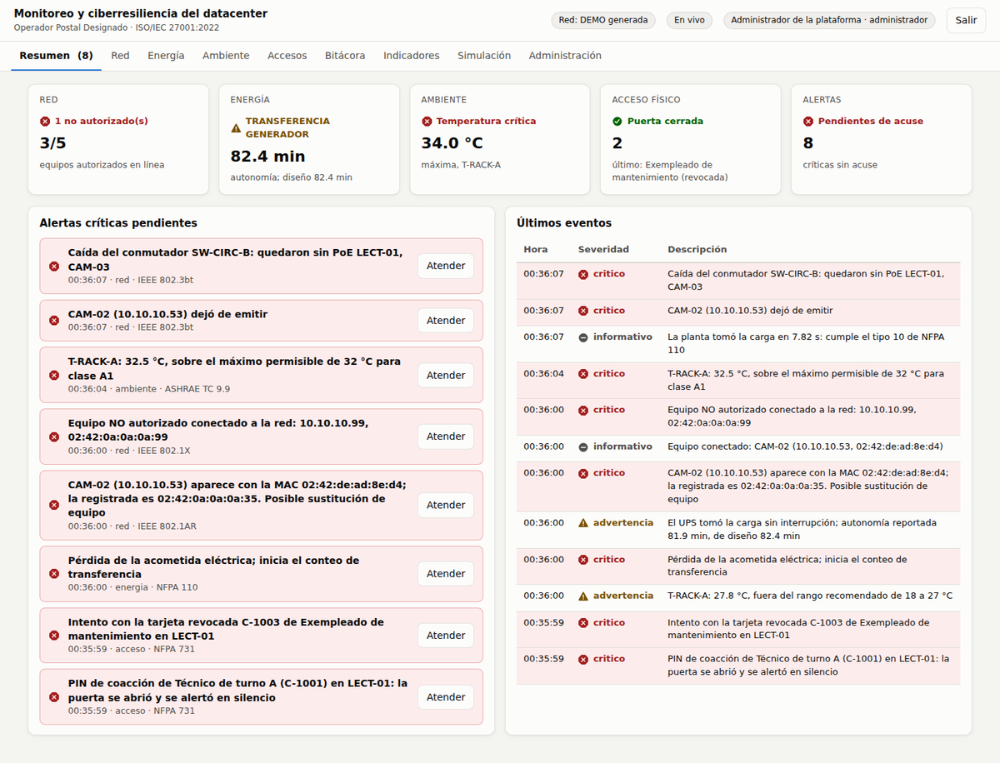
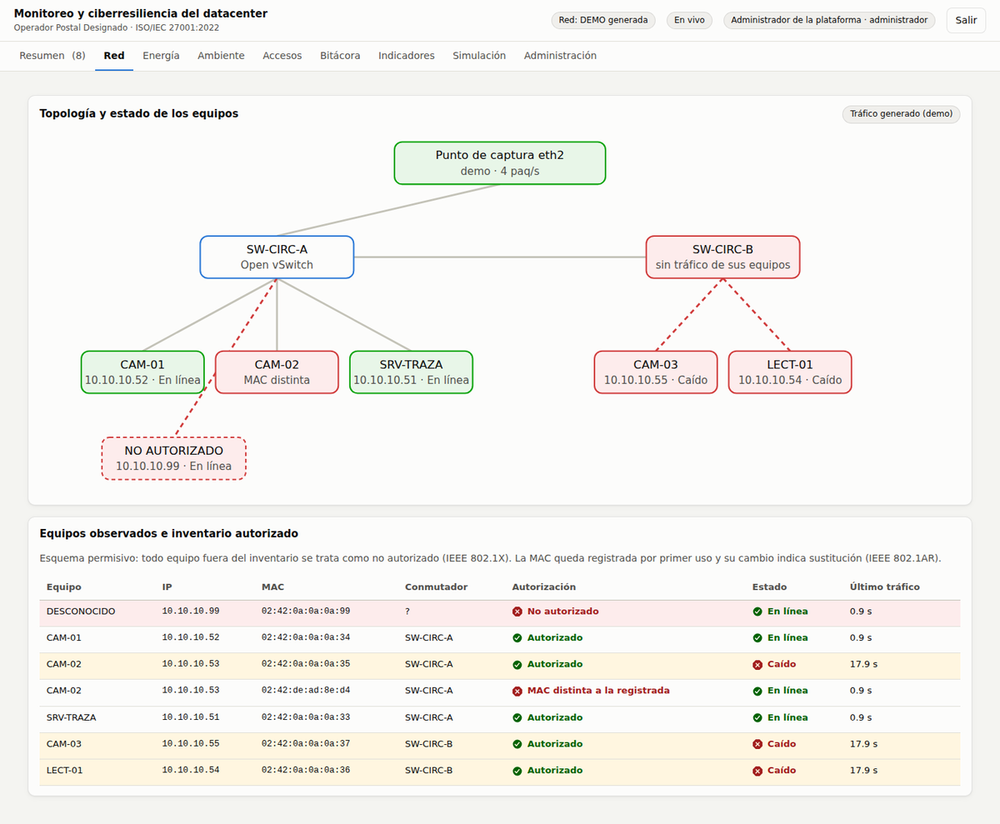
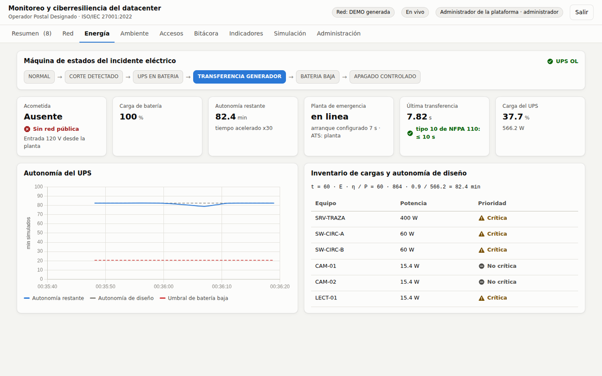
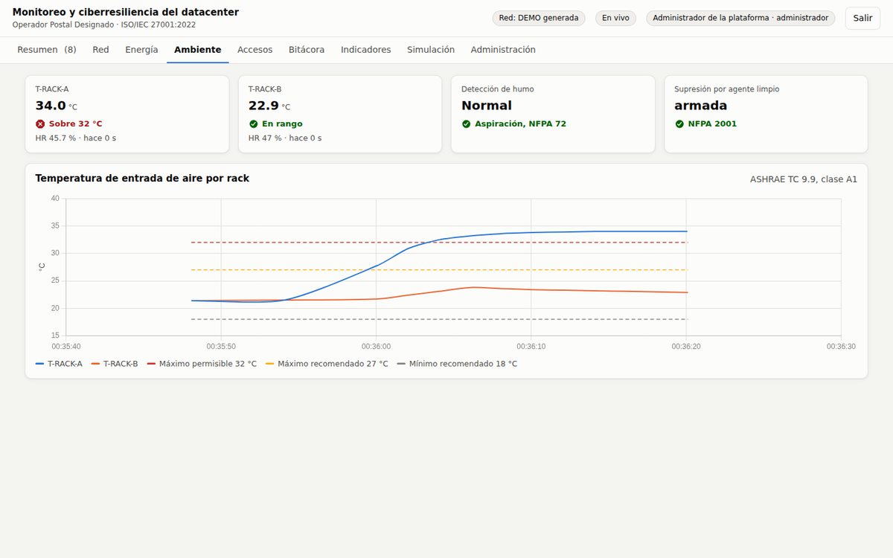
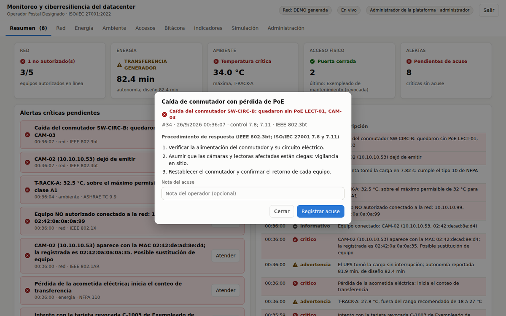
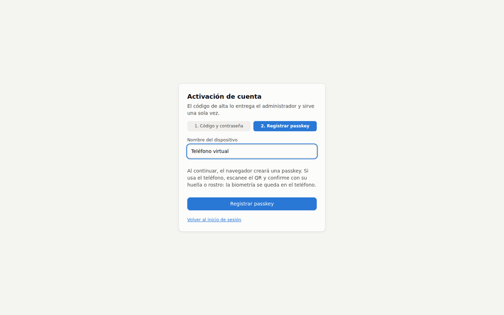

# Plataforma de Monitoreo y Ciberresiliencia del Datacenter
### Operador Postal Designado · Seguridad y Auditoría de Sistemas · UMG 2026

Plataforma web tipo DCIM/NOC que protege el *hardware* del datacenter: detecta,
alerta y registra de forma auditable los eventos de **red**, **energía (UPS y
planta)**, **ambiente (temperatura, humo y supresión)** y **acceso físico**, y
exige **autenticación multifactor con passkey** para operarla. Cada evento queda
en una bitácora con cadena de hash, trazable a un control de ISO/IEC 27001:2022
y a su norma técnica (NFPA, IEEE, ASHRAE, NIST).

```
 Red GNS3 (eth2) ──► sensor-red ─┐
 sim-ups ────────────────────────┤                 ┌──► Tablero web (HTTPS, WebSocket)
 sim-ambiente ───────────────────┼──► broker MQTT ─┤
 sim-puerta ◄────────────────────┘    (ACL)        └──► plataforma: reglas, bitácora, MFA
                                                          ▲
                                     proxy Caddy (CA local, https://plataforma.test)
```

| Servicio | Qué hace |
|---|---|
| `plataforma` | FastAPI: reglas por módulo, bitácora SQLite con cadena SHA-256, API, WebSocket, tablero y autenticación (bcrypt + WebAuthn) |
| `proxy` | Caddy con CA local: HTTPS, requisito de WebAuthn |
| `broker` | Mosquitto con usuario y ACL por servicio |
| `sensor-red` | Captura pasiva de `eth2` con solo `CAP_NET_RAW` (modo `captura`) o tráfico generado (modo `demo`) |
| `sim-ups` | UPS + conmutador de transferencia + planta, con variables de Network UPS Tools |
| `sim-ambiente` | Temperatura de entrada por rack, humo por aspiración y supresión por agente limpio |
| `sim-puerta` | Lectora de tarjeta + PIN, PIN de coacción, puerta forzada y mantenida abierta |

## Inicio rápido (GNS3 VM con Docker)

El código se copia a `~/plataforma` en la GNS3 VM; ahí corren los contenedores porque solo
la VM tiene `eth2` hacia la topología.

**Modo localhost (recomendado para trabajar).** La plataforma queda en `127.0.0.1:8000`
de la VM y Windows la abre por túnel SSH; `http://localhost` es contexto seguro para WebAuthn.

```bash
./scripts/generar_env.sh localhost     # .env con contraseñas aleatorias y COMPOSE_FILE del modo localhost
docker compose up -d --build
docker compose logs plataforma | grep "CÓDIGO DE ALTA"
```

```powershell
ssh -N -L 8000:127.0.0.1:8000 gns3@192.168.56.101     # en Windows; luego abrir http://localhost:8000/alta
```

**Modo https (passkey en el teléfono).** `./scripts/generar_env.sh` y
`docker compose --profile https up -d --build`; requiere el archivo `hosts` y la CA de Caddy
en Windows. Paso a paso en **[docs/DESPLIEGUE_GNS3.md](docs/DESPLIEGUE_GNS3.md)**.

Para trabajar con Claude Code desde Windows: **[docs/INICIO_CLAUDE_CODE.md](docs/INICIO_CLAUDE_CODE.md)**.

## Sin Docker o sin GNS3

```bash
pip install -r plataforma/requirements.txt -r sensor-red/requirements.txt
sudo apt-get install -y mosquitto            # el script usa mosquitto y mosquitto_passwd
./scripts/ejecutar_local.sh                  # modo demo: tráfico de red generado
# abrir http://localhost:8000/alta  (localhost es contexto seguro para WebAuthn)
```

En Docker, `MODO_RED=demo` en `.env` permite ensayar la demostración sin la topología GNS3.

## Documentación

| Documento | Contenido |
|---|---|
| [docs/MANUAL_SIMULACIONES.md](docs/MANUAL_SIMULACIONES.md) | **Para auditores**: marco normativo, escenarios de simulación, evidencia y trazabilidad |
| [docs/ACCESO_AUDITORES.md](docs/ACCESO_AUDITORES.md) | **Para auditores**: cómo entrar al laboratorio en la nube |
| [docs/MANUAL_SIMULACIONES_NUBE.md](docs/MANUAL_SIMULACIONES_NUBE.md) | **Para auditores**: manual en su versión para la nube; Word y PDF en [docs/entregables/](docs/entregables/) |
| [docs/ENTREGA_AUDITORIA.md](docs/ENTREGA_AUDITORIA.md) | Para el equipo: crear las cuentas de los auditores, entregar códigos y compartir la VM |
| [docs/CREAR_VM_AZURE.md](docs/CREAR_VM_AZURE.md) | Creación de la VM de Azure (portal o CLI) |
| [docs/DESPLIEGUE_NUBE.md](docs/DESPLIEGUE_NUBE.md) | Instalación en Azure con Tailscale y migración de la base |
| [docs/ARRANQUE.md](docs/ARRANQUE.md) | Arranque diario del laboratorio local y solución de problemas |
| [docs/VALIDACION_DEMO.md](docs/VALIDACION_DEMO.md), [docs/REGISTRO_VALIDACION.md](docs/REGISTRO_VALIDACION.md) | Protocolo y registro del ensayo de la demostración |
| [gns3/](gns3/README.md) | Proyecto GNS3 y configuración de red de cada nodo |
| [docs/ARQUITECTURA.md](docs/ARQUITECTURA.md) | Componentes, flujos, máquina de estados y decisiones de diseño |
| [docs/DESPLIEGUE_GNS3.md](docs/DESPLIEGUE_GNS3.md) | Instalación en la GNS3 VM, HTTPS, hosts, CA y passkeys |
| [docs/GUIA_DEMO.md](docs/GUIA_DEMO.md) | Guion de la demostración en vivo |
| [docs/SEGURIDAD.md](docs/SEGURIDAD.md) | MFA, roles, correcciones V1 a V10 y controles ISO/IEC 27001 |
| [docs/MQTT_TOPICOS.md](docs/MQTT_TOPICOS.md) | Contrato de mensajes del bus |
| [GUIA_INFRAESTRUCTURA.md](GUIA_INFRAESTRUCTURA.md) | Topología GNS3, adaptadores y ajustes de la VM |
| [docs/HANDOFF.md](docs/HANDOFF.md) | Estado del proyecto, decisiones y backlog priorizado |
| [docs/INICIO_CLAUDE_CODE.md](docs/INICIO_CLAUDE_CODE.md) | Cómo continuar con Claude Code desde Windows (disco D:, localhost) |

## Estructura

```
plataforma/      backend FastAPI (app/) y frontend sin compilación (static/)
sensor-red/      capturador de tráfico
simuladores/     sim-ups, sim-ambiente, sim-puerta
broker/          configuración y ACL de Mosquitto
proxy/           Caddyfile
scripts/         generar_env.sh, ejecutar_local.sh, prueba_e2e.py
scripts/windows/ desplegar.ps1, tunel.ps1, evidencia.ps1 (operación desde Windows)
scripts/nube/    preparar_vm.sh (VM de Azure)
gns3/            proyecto GNS3 y configuración de los nodos
docs/            documentación técnica
```

## Prueba de punta a punta

`scripts/prueba_e2e.py` abre Chromium con un autenticador WebAuthn virtual, activa
la cuenta del administrador, inicia sesión con contraseña y passkey, inyecta los
escenarios de la demostración, registra un acuse, crea un operador y verifica la
cadena de hash:

```bash
ADMIN_CODIGO_ALTA=ABCD-EFGH-JKLM ./scripts/ejecutar_local.sh &
python3 scripts/prueba_e2e.py http://localhost:8000 ABCD-EFGH-JKLM capturas/
```

## Autores
- Gerardo Antonio Ovando Hernández, 9490-21-7
- Mario Andrés Culajay Roldán, 9490-22-5771
- Sergio Enrique Sánchez Sánchez, 9490-21-1077

Universidad Mariano Gálvez de Guatemala, 2026

## Capturas

| Resumen con alertas pendientes | Topología y detección en la red |
|---|---|
|  |  |
| **Máquina de estados de energía** | **Temperatura contra ASHRAE** |
|  |  |
| **Procedimiento de respuesta y acuse** | **Alta con passkey** |
|  |  |
