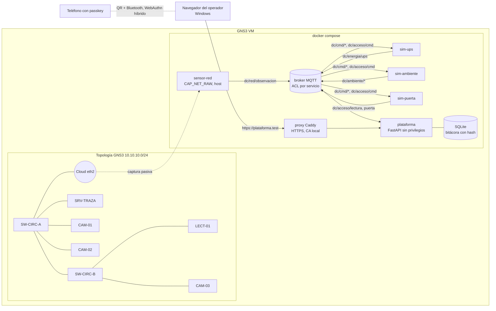

# Arquitectura de la plataforma v2

## 1. Principio de diseño

Los dispositivos simulados reproducen la **física**: la batería se descarga, la sala
se calienta, la puerta se abre. La plataforma aplica la **norma**: el tipo 10 de NFPA 110,
los rangos de ASHRAE, las reglas de NFPA 731. Así funciona un DCIM real, donde la tarjeta
de gestión del UPS reporta variables y el software de monitoreo decide si hay incidente.
Gracias a esa separación, un sensor físico futuro podría reemplazar a un simulador
publicando en el mismo tema MQTT, sin tocar las reglas.

## 2. Componentes



| Capa | Tecnología | Archivo principal |
|---|---|---|
| Ingesta | paho-mqtt 2.1, Mosquitto 2 | `plataforma/app/bus.py` |
| Reglas | Python, un módulo por frente | `plataforma/app/modulos/{red,energia,ambiente,acceso}.py` |
| Evidencia | SQLite WAL, cadena SHA-256 | `plataforma/app/bitacora.py` |
| Autenticación | bcrypt, py_webauthn 3.0 | `plataforma/app/auth/` |
| API y tiempo real | FastAPI, WebSocket | `plataforma/app/api.py`, `main.py` |
| Tablero | HTML, JavaScript con módulos ES, Chart.js 4 | `plataforma/static/` |

## 3. Máquina de estados de energía

```mermaid
stateDiagram-v2
  [*] --> NORMAL
  NORMAL --> CORTE_DETECTADO: pérdida de acometida (t0)
  CORTE_DETECTADO --> UPS_EN_BATERIA: ups.status = OB (NFPA 111)
  UPS_EN_BATERIA --> TRANSFERENCIA_GENERADOR: planta en línea; t = t_en_linea - t0 vs tipo 10 (NFPA 110)
  TRANSFERENCIA_GENERADOR --> UPS_EN_BATERIA: falla de planta
  UPS_EN_BATERIA --> BATERIA_BAJA: autonomía < 25 % del diseño
  BATERIA_BAJA --> APAGADO_CONTROLADO: autonomía agotada
  CORTE_DETECTADO --> NORMAL: retorno
  UPS_EN_BATERIA --> NORMAL: retorno
  TRANSFERENCIA_GENERADOR --> NORMAL: retorno
  BATERIA_BAJA --> NORMAL: retorno
```

Autonomía de diseño: `t = 60 · E · η / P = 60 · 864 · 0.90 / 566.2 = 82.4 min`.
La descarga se acelera con `FACTOR_TIEMPO` (x30 por defecto) para que el escenario
dure minutos; el arranque de la planta corre en segundos reales para que el tiempo
de transferencia medido sea comparable con el tipo 10.

La climatización es carga de la planta, no del UPS: si la planta falla, `sim-ambiente`
deja de enfriar y la temperatura sube. Esa interacción reproduce una cadena de fallas real.

## 4. Autenticación multifactor

```mermaid
sequenceDiagram
  participant O as Operador
  participant N as Navegador
  participant P as Plataforma
  participant A as Autenticador (teléfono, llave FIDO2, Windows Hello)
  O->>N: usuario + contraseña
  N->>P: POST /api/auth/login
  P->>P: bcrypt, límite de intentos
  P-->>N: sesión en etapa mfa_pendiente (cookie HttpOnly, SameSite=Strict)
  N->>P: POST /api/auth/passkey/login/opciones
  P-->>N: desafío + credenciales permitidas, userVerification=required
  N->>A: navigator.credentials.get()
  A->>O: huella, rostro o PIN local
  A-->>N: firma del desafío ligada al origen
  N->>P: POST /api/auth/passkey/login/verificar
  P->>P: verifica firma, RP ID, origen y UV
  P-->>N: sesión completa; evento auth_exitosa (8.5)
```

- **Alta**: el administrador crea la cuenta y recibe un código de un solo uso con
  vencimiento de 24 horas. El usuario lo canjea en `/alta`, define su contraseña y registra
  su passkey; el código queda anulado al completar el registro.
- **Reautenticación**: crear usuarios, dar de baja, revocar tarjetas y cambiar el inventario
  exigen una firma con la passkey en los últimos `REAUTH_MIN` minutos.
- **Baja**: desactiva la cuenta, revoca todas sus passkeys y cierra sus sesiones en la
  misma transacción; el evento registra cuántas credenciales se revocaron.

## 5. Bitácora

Tabla `eventos` de solo inserción:

```
hash_n = SHA-256( hash_{n-1} || JSON[ts, modulo, tipo, severidad, descripcion,
                                     control_iso, norma, actor, ref_id, datos] )
```

- Un acuse es un evento nuevo con `ref_id` apuntando a la alerta: no se reescribe nada.
- `GET /api/bitacora/verificar` recorre la cadena y devuelve el primer evento roto.
- La exportación CSV incluye `hash_anterior` y `hash` para verificación externa.
- `actor` distingue `sistema`, `administrador:admin`, `operador:operador1` o `anonimo`;
  los eventos inyectados desde la consola quedan marcados en el módulo `simulacion`.

## 6. Decisiones y alternativas descartadas

| Decisión | Motivo | Alternativa descartada |
|---|---|---|
| MQTT como bus | Desacopla dispositivos y reglas; es el protocolo de muchos sensores IoT | Llamadas HTTP directas: acopla y no permite varios consumidores |
| Variables NUT en el UPS | Son los nombres que reporta un UPS real vía Network UPS Tools | Formato propio |
| Captura pasiva en contenedor aparte | La web ya no necesita root (V6) | `sudo uvicorn` de la v1 |
| SQLite | Suficiente para un escritor; un archivo fácil de respaldar y auditar | PostgreSQL: más operación sin beneficio en el laboratorio |
| HTML + JS sin compilación | Cero herramientas de construcción, CSP estricta sin `unsafe-inline` | React con Vite: más rápido de escalar, más lento de montar |
| Topología SVG propia | Compatible con la CSP y liviana | vis-network: inyecta estilos en línea |
| Caddy con `tls internal` | Certificado automático con CA local, requisito de WebAuthn | Certificado autofirmado manual |
